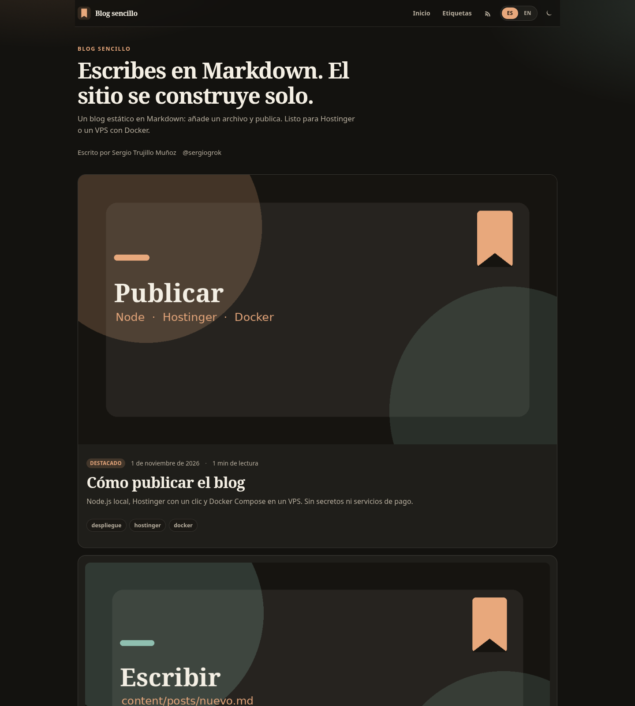

# blog-sencillo

Blog autoalojado en Markdown. Un archivo por artículo, salida estática con [Astro](https://astro.build), lista para Hostinger y para un VPS con Docker Compose.

[](https://www.hostinger.com/deploy?template=serg-hash/blog-sencillo&ref=TU_CODIGO_SOCIO)

> **Código de socio:** deja `TU_CODIGO_SOCIO` hasta inscribirte en el [programa Open Source Partners de Hostinger](https://www.hostinger.com/open-source-partners). Después sustituye el placeholder por tu código.

[](https://github.com/serg-hash/blog-sencillo/actions/workflows/ci.yml)
[](LICENSE)
[](https://astro.build)



Vista de un artículo: [docs/screenshot-post.png](docs/screenshot-post.png)

Cambia el nombre, el autor y las redes en `src/config.ts`. Los artículos son archivos `.md` en `content/posts/`.

## Características

- **Un archivo de config** (`src/config.ts`): nombre del sitio, autor, URL pública, redes y artículos por página.
- **Un Markdown = un artículo**, con frontmatter (`title`, `date`, `description`, `tags`, `cover` opcional, `draft`).
- **Portada** con listado (más nuevos primero), **páginas de artículo**, **etiquetas**, **paginación**, **RSS** y **sitemap**.
- **Interfaz en español e inglés** (`/` y `/en/`), conmutador en la cabecera. Las cadenas están en `src/i18n.ts`.
- **Tema claro / oscuro** (respeta el sistema y se puede fijar). **Tiempo de lectura**, SEO, Open Graph y JSON-LD.
- **Móvil primero**, accesible (`:focus-visible`, skip-link, contraste, `prefers-reduced-motion`).
- **Sin rastreo**, sin secretos ni servicios de pago. `npm install` → `npm run build` → carpeta `dist/`.
- **Docker Compose** para VPS y botón **Deploy on Hostinger**.

## Inicio rápido

Requisitos: [Node.js 22.12+](https://nodejs.org/) (Astro 7).

```bash
git clone https://github.com/serg-hash/blog-sencillo.git
cd blog-sencillo
npm install
npm run dev
```

Abre [http://localhost:4321](http://localhost:4321). Para producción local:

```bash
npm run build
npm run preview
```

La build deja el sitio en `dist/`. Ese es el directorio que Hostinger (y cualquier host estático) debe publicar.

## Cómo escribir artículos

Crea un archivo en `content/posts/`, por ejemplo `content/posts/hola.md`:

```yaml
---
title: "Hola"
description: "Mi primer artículo."
date: 2026-11-02
tags: ["inicio"]
cover: "/covers/bienvenida.png"
draft: false
---

Texto en Markdown.
```

El nombre del archivo (sin `.md`) es el slug: `/articulo/hola`. Con `draft: true` no se publica en `npm run build`; en desarrollo sí se ve.

Edita **`src/config.ts`** para el resto:

| Campo | Qué cambia |
| --- | --- |
| `site.url` | URL pública (canonical, OG, RSS, sitemap) |
| `site.name`, `title`, `description`, `tagline` | Identidad del blog |
| `site.author` | Nombre, handle y URL |
| `site.socials` | Iconos de GitHub, X, YouTube… |
| `site.postsPerPage` | Paginación del listado |
| `site.showLanguageSwitch` | Conmutador ES / EN |

Los textos de la interfaz (botones, «min de lectura», pie…) están en `src/i18n.ts`.

Los tres artículos de ejemplo en `content/posts/` explican el propio blog; bórralos o sustitúyelos cuando escribas los tuyos.

## Desplegar

### Hostinger (un clic / Node.js)

1. Pulsa el botón **Deploy on Hostinger** del principio (o sube este repo en hPanel → sitio Node.js).
2. Hostinger detecta Astro con estos valores; si te pide confirmarlos:

   | Campo | Valor |
   | --- | --- |
   | Tipo de aplicación | `astro` |
   | Script de build | `build` |
   | Directorio de salida | `dist` |
   | Entry file | *(vacío — es un sitio estático)* |
   | Node.js | 22 |

3. No hace falta ninguna variable de entorno.

Más detalle: [Astro en Hostinger](https://docs.hostinger.com/node.js/overview-1/astro).

### Docker / VPS

```bash
docker compose up --build -d
```

El blog queda en [http://localhost:8080](http://localhost:8080). En un VPS de Hostinger, Docker Manager puede usar el `docker-compose.yml` de este repo. Para publicar en el puerto 80, cambia el mapeo a `"80:80"`.

### Otros hosts estáticos

`npm run build` y publica `dist/` en Netlify, Cloudflare Pages, GitHub Pages, Nginx, etc.

| Host | Build | Publicar |
| --- | --- | --- |
| Netlify / Cloudflare Pages | `npm run build` | `dist` |
| GitHub Pages | `npm run build` | contenido de `dist` |
| Nginx | `npm run build` | `root` → `dist` |

## Temas sugeridos del repositorio

Si eres el dueño del repo, en GitHub → About → Topics:

`astro` · `blog` · `markdown` · `self-hosted` · `hostinger` · `docker` · `docker-compose` · `static-site` · `rss` · `spanish` · `open-source` · `mit-license` · `no-tracking`

## Créditos

Hecho por **Sergio Trujillo Muñoz** ([serg-hash](https://github.com/serg-hash) / [@sergiogrok](https://x.com/sergiogrok)).

Licencia [MIT](LICENSE). Contribuciones: [CONTRIBUTING.md](CONTRIBUTING.md).

---

# English

Self-hosted Markdown blog. One file per post, static Astro output, ready for Hostinger’s Open Source Partners program and for a VPS with Docker Compose.

[](https://www.hostinger.com/deploy?template=serg-hash/blog-sencillo&ref=TU_CODIGO_SOCIO)

> **Partner code:** leave `TU_CODIGO_SOCIO` until you join [Hostinger Open Source Partners](https://www.hostinger.com/open-source-partners), then replace the placeholder.

## Features

- Single config file (`src/config.ts`) plus Markdown posts in `content/posts/`.
- Home list (newest first), post pages, tags, pagination, RSS, sitemap, reading time, SEO/Open Graph.
- Spanish + English UI (`/` and `/en/`), dark/light mode, mobile-first, accessible, no tracking.
- `npm install` / `npm run build` / `dist/` works out of the box.
- Dockerfile + `docker-compose.yml` for VPS deploys.

## Quick start

```bash
npm install
npm run dev
```

Edit `src/config.ts`, add `.md` files under `content/posts/`, then `npm run build`. Output is `dist/`.

A post looks like this:

```yaml
---
title: "Hello"
description: "My first post."
date: 2026-11-02
tags: ["hello"]
draft: false
---
```

`draft: true` hides it from production builds.

## Deploy

**Hostinger one-click:** use the button above. Build script `build`, output directory `dist`, leave the entry file empty (static Astro). Node 22.

**Docker:** `docker compose up --build -d` → http://localhost:8080

**Any static host:** publish the `dist/` folder.

## License

MIT © Sergio Trujillo Muñoz / serg-hash
