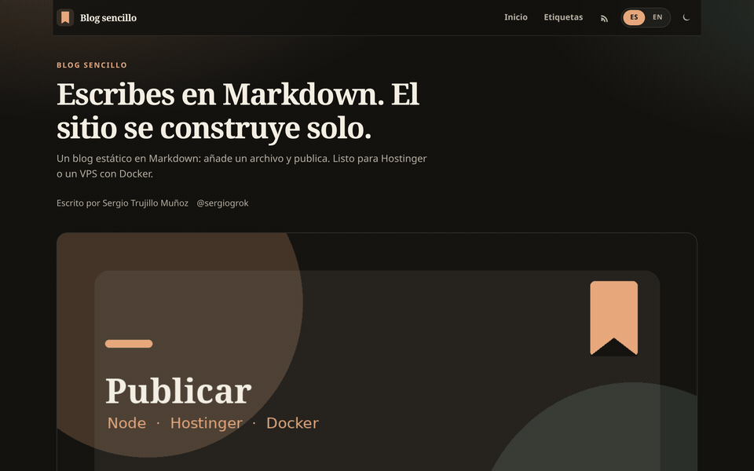

# blog-sencillo

Plantilla mínima de blog en Markdown: **español primero**, UI bilingüe de fábrica, HTML estático. Sin CMS, sin framework de JavaScript que mantener y sin rastreo.

**[Probar la demo](https://serg-hash.github.io/blog-sencillo/)** · [English UI](https://serg-hash.github.io/blog-sencillo/en/) · [Código](https://github.com/serg-hash/blog-sencillo)

<!-- Maintainers: append &ref=CODE to the Hostinger URL when a real partner code exists. See CONTRIBUTING.md. -->
[](https://www.hostinger.com/deploy?template=serg-hash/blog-sencillo)

[](https://github.com/serg-hash/blog-sencillo/actions/workflows/ci.yml)
[](https://serg-hash.github.io/blog-sencillo/)
[](LICENSE)
[](https://astro.build)



Capturas fijas: [portada](docs/screenshot-desktop.png) · [artículo](docs/screenshot-post.png)

Cambia el nombre, el autor y las redes en `src/config.ts`. Los artículos son archivos `.md` en `content/posts/`.

## Características

- **Un archivo de config** (`src/config.ts`): nombre del sitio, autor, URL pública, redes y artículos por página.
- **Un Markdown = un artículo**, con frontmatter (`title`, `date`, `description`, `tags`, `cover` opcional, `draft`).
- **Portada** con listado (más nuevos primero), **páginas de artículo**, **etiquetas**, **paginación**, **RSS** y **sitemap**.
- **Interfaz en español e inglés** (`/` y `/en/`), conmutador en la cabecera. Las cadenas están en `src/i18n.ts`. Los artículos se publican en el idioma en el que los escribes (los de ejemplo van en español).
- **Tema claro / oscuro** (respeta el sistema y se puede fijar). **Tiempo de lectura**, SEO, Open Graph y JSON-LD.
- **Móvil primero**, accesible (`:focus-visible`, skip-link, contraste, `prefers-reduced-motion`).
- **Sin rastreo**, sin secretos ni servicios de pago. `npm install` → `npm run build` → carpeta `dist/`.
- **GitHub Pages**, **Hostinger** o **Docker Compose** en un VPS.

## Por qué esta plantilla (y no AstroWind, AstroPaper o Fuwari)

Esas plantillas son excelentes y tienen miles de estrellas. Cubren marketing sites, MDX, muchos layouts y un ecosistema grande. **blog-sencillo no intenta competir en superficie.** Es la opción pequeña:

| | blog-sencillo | Plantillas grandes (AstroWind, AstroPaper, Fuwari, …) |
| --- | --- | --- |
| Idioma por defecto | Español (`/`), inglés en `/en/` | Casi siempre inglés primero |
| Superficie | Un listado + artículos + etiquetas | Temas, landings, MDX, extras |
| Runtime JS | Solo el conmutador de tema (unas líneas) | A menudo islas React/Vue/Svelte o más JS |
| Configuración | Un archivo + Markdown | Más convenciones y opciones |
| Para quién | Escribir y publicar sin montar un frontend | Quien quiere un kit completo |

Si te basta un blog en Markdown, bilingüe y autoalojable, esta plantilla es deliberadamente poca cosa. Si necesitas un tema de revista o un sitio de producto, usa una de las grandes.

## Inicio rápido

Requisitos: [Node.js 22.12+](https://nodejs.org/) (Astro 7).

```bash
git clone https://github.com/serg-hash/blog-sencillo.git
cd blog-sencillo
npm install
npm run dev
```

Abre [http://localhost:4321](http://localhost:4321). Para producción local:

```bash
npm run build
npm run preview
```

La build deja el sitio en `dist/`. Ese es el directorio que cualquier host estático debe publicar.

## Cómo escribir artículos

Crea un archivo en `content/posts/`, por ejemplo `content/posts/hola.md`:

```yaml
---
title: "Hola"
description: "Mi primer artículo."
date: 2026-11-02
tags: ["inicio"]
cover: "/covers/bienvenida.png"
draft: false
---

Texto en Markdown.
```

El nombre del archivo (sin `.md`) es el slug: `/articulo/hola`. Con `draft: true` no se publica en `npm run build`; en desarrollo sí se ve.

Edita **`src/config.ts`** para el resto:

| Campo | Qué cambia |
| --- | --- |
| `site.url` | URL pública (canonical, OG, RSS, sitemap) |
| `site.name`, `title`, `description`, `tagline` | Identidad del blog |
| `site.author` | Nombre, handle y URL |
| `site.socials` | Iconos de GitHub, X, YouTube… |
| `site.postsPerPage` | Paginación del listado |
| `site.showLanguageSwitch` | Conmutador ES / EN |

Los textos de la interfaz (botones, «min de lectura», pie…) están en `src/i18n.ts`.

Los tres artículos de ejemplo en `content/posts/` explican el propio blog; bórralos o sustitúyelos cuando escribas los tuyos.

## Desplegar

### GitHub Pages (la demo de este repo)

1. En el repositorio: **Settings → Pages → Source: GitHub Actions**.
2. Empuja a `main`. El workflow [`.github/workflows/pages.yml`](.github/workflows/pages.yml) construye con `SITE_URL` y `BASE_PATH=/nombre-del-repo` para que los enlaces funcionen bajo `https://USUARIO.github.io/REPO/`.
3. La demo de **blog-sencillo** queda en [https://serg-hash.github.io/blog-sencillo/](https://serg-hash.github.io/blog-sencillo/).

No hace falta tocar `src/config.ts` para esa demo: las variables las pone el workflow. En un dominio en la raíz (Hostinger, Netlify, un VPS) deja `BASE_PATH` sin definir.

### Hostinger

1. Pulsa **Deploy on Hostinger** arriba, o sube este repo en hPanel → sitio Node.js.
2. Hostinger detecta Astro con estos valores; si te pide confirmarlos:

   | Campo | Valor |
   | --- | --- |
   | Tipo de aplicación | `astro` |
   | Script de build | `build` |
   | Directorio de salida | `dist` |
   | Entry file | *(vacío — es un sitio estático)* |
   | Node.js | 22 |

3. Pon tu URL pública en `src/config.ts` (`site.url`). No hace falta ninguna variable de entorno.

Más detalle: [Astro en Hostinger](https://docs.hostinger.com/node.js/overview-1/astro).

### Cualquier host estático

`npm run build` y publica `dist/` en Netlify, Cloudflare Pages, Nginx, etc.

| Host | Build | Publicar |
| --- | --- | --- |
| Netlify / Cloudflare Pages | `npm run build` | `dist` |
| GitHub Pages | workflow de este repo | `dist` (con `BASE_PATH`) |
| Nginx / VPS | `npm run build` | `root` → `dist` |

### Docker / VPS

```bash
docker compose up --build -d
```

El blog queda en [http://localhost:8080](http://localhost:8080). En un VPS, Docker Manager puede usar el `docker-compose.yml` de este repo. Para publicar en el puerto 80, cambia el mapeo a `"80:80"`.

## Créditos

Hecho por **Sergio Trujillo Muñoz** ([serg-hash](https://github.com/serg-hash) / [@sergiogrok](https://x.com/sergiogrok)).

Licencia [MIT](LICENSE). Contribuciones: [CONTRIBUTING.md](CONTRIBUTING.md). Cambios: [CHANGELOG.md](CHANGELOG.md).

---

# English

A small Markdown blog template: **Spanish-first**, bilingual UI out of the box, static HTML. No CMS, no JavaScript framework to maintain, no tracking.

**[Live demo](https://serg-hash.github.io/blog-sencillo/)** · [English UI](https://serg-hash.github.io/blog-sencillo/en/)

[](https://www.hostinger.com/deploy?template=serg-hash/blog-sencillo)


Edit `src/config.ts`, add `.md` files under `content/posts/`, then `npm run build`. Output is `dist/`.

## Why this, not AstroWind / AstroPaper / Fuwari

Those templates are the right pick when you want a full theme kit. This one stays small on purpose: Spanish as the default locale, English chrome at `/en/`, one Markdown file per post, one config file, and almost no client JavaScript (only the theme toggle). Posts are not auto-translated — you write them in whatever language you want; the sample posts are Spanish.

## Quick start

```bash
npm install
npm run dev
```

A post looks like this:

```yaml
---
title: "Hello"
description: "My first post."
date: 2026-11-02
tags: ["hello"]
draft: false
---
```

`draft: true` hides it from production builds.

## Deploy

**GitHub Pages:** Settings → Pages → Source: **GitHub Actions**. The workflow in this repo sets `SITE_URL` and `BASE_PATH` so the site works at `https://USER.github.io/REPO/`. Demo: [https://serg-hash.github.io/blog-sencillo/](https://serg-hash.github.io/blog-sencillo/).

**Hostinger:** use the button above. Build script `build`, output directory `dist`, leave the entry file empty (static Astro). Node 22. Put your public URL in `src/config.ts`.

**Any static host:** publish the `dist/` folder. Do not set `BASE_PATH` when the site lives at the domain root.

**Docker:** `docker compose up --build -d` → http://localhost:8080

## License

MIT © Sergio Trujillo Muñoz / serg-hash
